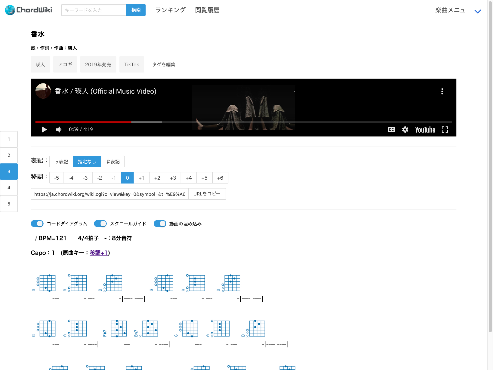

# ChordWiki Plus

[ChordWiki](https://ja.chordwiki.org/)に機能を追加します。



## 機能

- 🎼 移調ボタン
- 📝 表記変更ボタン
- 📋 URL コピーボタン
- ➖ スクロールガイド
- 🎸 コードダイアグラム表示
- 🔗 移調テキストの自動リンク化
- 📜 自動スクロールボタン
- 🎦 YouTube のインライン再生
- 🎦 ニコニコ動画のインライン再生
- 🥁 簡易メトロノーム
- 🔍 検索フォーム
- 💬 わかりやすいコメント

## 対応ブラウザ

- ✅ Google Chrome （[Google Chrome 版をインストール](https://chrome.google.com/webstore/detail/chordwiki-plus-chordwiki%E3%81%8C/okpomplfbfbmabonmfloendefonobaco?hl=ja)）
- ✅ Mozilla Firefox（申請中）
- ✅ Opera（申請中）
- ✅ Microsoft Edge（申請中）

## 開発の始め方

```
npm install
npm run watch:dev
```

`dist` をブラウザに読み込ませ、`src` ディレクトリのファイルを編集してください。

## ビルド手順

```
npm install
rm -rf ./dist
rm -rf ./dist-zip
npm run build
npm run build-zip
```

`dist-zip` ディレクトリに各ブラウザ用のパッケージがビルドされます。

## 動作確認

- 転調ごとにキーが設定されている楽曲
  - https://ja.chordwiki.org/wiki.cgi?c=view&key=0&symbol=&t=%E5%A4%9C%E3%81%AB%E9%A7%86%E3%81%91%E3%82%8B%20%28YOASOBI%29
- ♣♠♥♦ が含まれている楽曲
  - https://ja.chordwiki.org/wiki.cgi?c=view&key=0&symbol=&t=%E7%A7%81%E3%81%8C%E3%83%A2%E3%83%86%E3%81%AA%E3%81%84%E3%81%AE%E3%81%AF%E3%81%A9%E3%81%86%E8%80%83%E3%81%88%E3%81%A6%E3%82%82%E3%81%8A%E5%89%8D%E3%82%89%E3%81%8C%E6%82%AA%E3%81%84
- コード以外の文字が含まれている楽曲
  - https://ja.chordwiki.org/wiki.cgi?c=view&key=0&symbol=&t=%E3%83%86%E3%83%AC%E3%82%AD%E3%83%A3%E3%82%B9%E3%82%BF%E3%83%BC%E3%83%93%E3%83%BC%E3%83%9C%E3%83%BC%E3%82%A4
- タイトル、サブタイトル、タグなどがない楽曲
  - https://ja.chordwiki.org/wiki.cgi?c=view&key=0&symbol=&t=%E7%B7%B4%E7%BF%92%E7%94%A8
- 実体参照が必要な文字( `<` `>`など)が含まれている楽曲
  - https://ja.chordwiki.org/wiki.cgi?c=view&key=0&symbol=&t=%E3%83%96%E3%83%AB%E3%83%BC%E3%82%A6%E3%82%A9%E3%83%BC%E3%82%BF%E3%83%BC

## ライセンス

MIT License です。詳しくは [LICENSE](./LICENSE) を参照してください。
